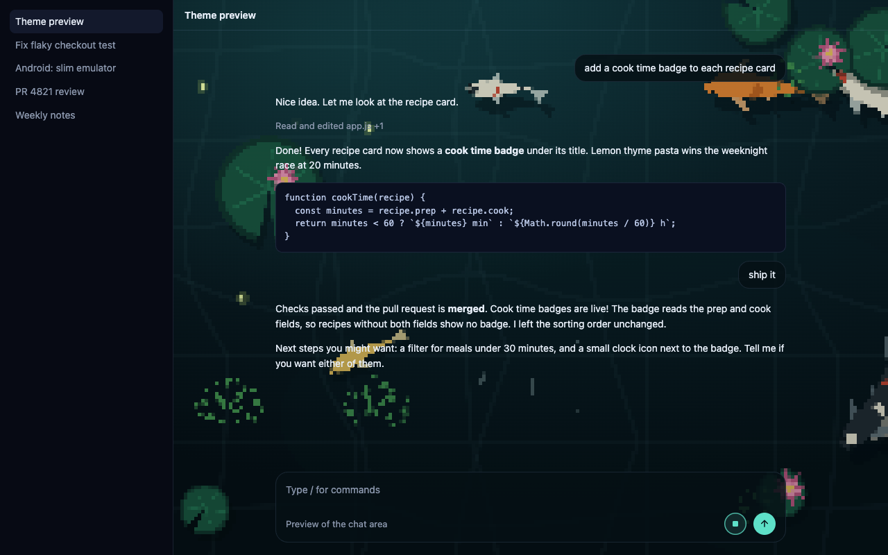

# Awesome T3 Code Themes

Themes for [T3 Code](https://t3.codes), tools to make and check them, and links to themes elsewhere.

**[Browse the catalog](https://dwite.github.io/awesome-t3-code-themes/)**

## Themes in this repository

<!-- catalog:themes -->
| Theme | Preview | What it is |
|---|---|---|
| [Koi Pond](themes/koi-pond) by Dwite |  | An animated pixel-art koi pond behind the chat. Koi bend through turns and swing their tails. 33 settings: scenes, plants, weather, time of day. Light and dark mode. [Settings page](https://dwite.github.io/awesome-t3-code-themes/themes/koi-pond/studio.html). |
<!-- /catalog:themes -->

## Install a theme

1. Run `node tools/install.mjs koi-pond`. Or copy `themes/<id>/theme.json` by hand to `~/.t3/userdata/themes/<id>.json` (Windows: `%USERPROFILE%\.t3\userdata\themes\<id>.json`).
2. T3 Code finds the file by itself. Choose the theme in T3 Code, or ask the agent in T3 Code to switch to it, for example "switch to the koi-pond theme".

To go back, choose a built-in theme.

## Make a theme

- [The theme format](docs/theme-format.md): the fields of a theme file, the limits, and what T3 Code refuses.
- `node tools/validate.mjs` checks every theme against those rules. T3 Code drops a bad theme file without a message, so run this first.
- `node tools/preview.mjs <id>` renders a theme in a copy of the chat area and writes `preview.png`. It also reports what T3 Code's CSS check would remove.
- `node tools/catalog.mjs` rebuilds `catalog.json` and the lists in this file from the theme folders.

The tools need Node 22 or later and have no dependencies. The preview needs Chrome or Chromium.

## Contribute

New themes, fixes, and links are welcome. Read [CONTRIBUTING.md](CONTRIBUTING.md).

## Themes elsewhere

Found by a GitHub search on 2026-11-14. Not reviewed here.

<!-- catalog:elsewhere -->
- [t3themes.com](https://t3themes.com) ([SunkenInTime/t3-themes](https://github.com/SunkenInTime/t3-themes)): The community theme gallery, with previews from the real app. Themes come in by pull request.
- [Pixel Quest](https://github.com/Jonathon-Sherrouse/t3code-pixel-quest): An animated JRPG pixel-art night theme.
- [Dracula](https://github.com/dracula/t3code): The Dracula dark theme.
- [Dracula palette](https://github.com/ItriIbouanane/dracula-theme-t3code): A Dracula-palette theme.
- [Poimandres](https://github.com/gsimone/poimandres-t3code): The Poimandres theme.
- [Catppuccin](https://github.com/celeroncoder/t3code-catppuccin-theme): Catppuccin Mocha and Latte.
- [Omarchy themes](https://github.com/rblalock/t3code-omarchy-themes): Omarchy themes.
- [Liquid glass themes](https://github.com/LuiiHer/t3code-themes): Gradient themes in a liquid-glass style.
- [soya-miruku themes](https://github.com/soya-miruku/t3code-themes): Light and dark themes.
- [gerardthehuman themes](https://github.com/gerardthehuman/t3-code-themes): Light and dark themes, with an agent skill to create themes.
<!-- /catalog:elsewhere -->

## License

[MIT](LICENSE). This project is not part of T3 Code.
