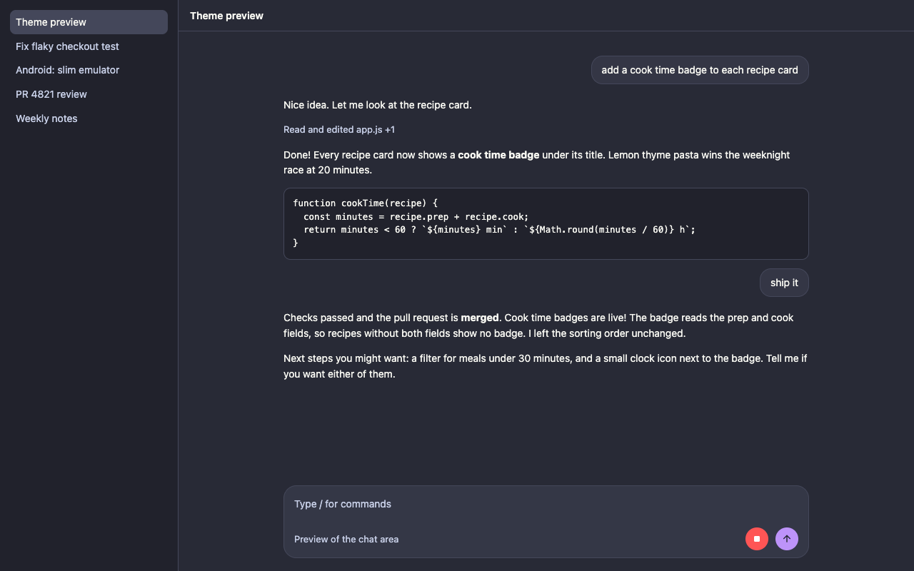

# Dracula

The Dracula dark theme for T3 Code, from the Dracula Theme project.

## Credit

By [dracula](https://github.com/dracula). Imported from [dracula/t3code](https://github.com/dracula/t3code) at commit `9094377459`, file `Dracula.json`, under the MIT license. The license text is in [third-party/dracula-t3code](../../third-party/dracula-t3code).

Changed here: the gallery-only fields (id, author, description, collection) moved to `meta.json`. The colours are as the author wrote them.

## Install

`node tools/install.mjs dracula` from the repository root, or copy `theme.json` to `~/.t3/userdata/themes/dracula.json`. Then choose "Dracula" in T3 Code.
