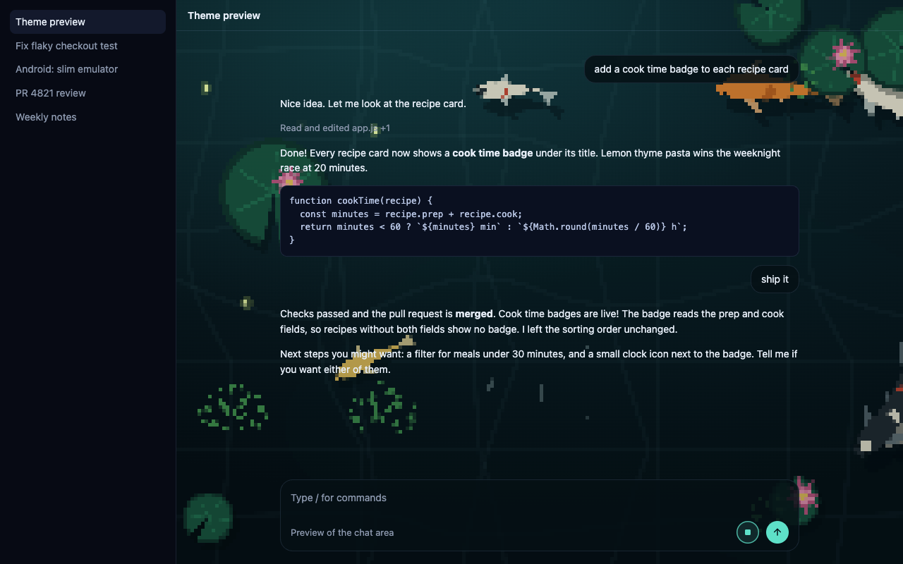
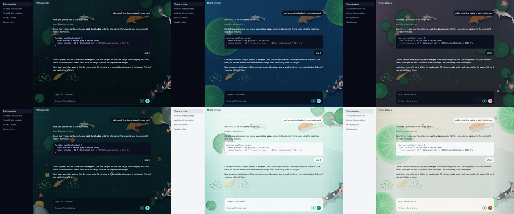

# Koi Pond

A koi pond behind the chat in T3 Code: pixel-art koi that bend through turns and swing their tails, plants, weather, and time of day. It follows light and dark mode.

Four scenes, in dark and light mode:

Inspired by [Nagomi](https://github.com/msk1039/nagomi), an interactive koi pond for the browser. The code and the art here are our own.

## Install

`node tools/install.mjs koi-pond` from the repository root, or copy `theme.json` to `~/.t3/userdata/themes/koi-pond.json`. Then choose "Koi Pond" in T3 Code.

## Change the settings

There are 33 settings.

- **Settings page:** open [the online settings page](https://dwite.github.io/awesome-t3-code-themes/themes/koi-pond/studio.html), or `studio.html` from a checkout, in Chrome or another Chromium browser. The preview is the real theme. **Save to T3 Code** asks once for the themes folder (`~/.t3/userdata/themes`; in the macOS folder dialog press Cmd+Shift+G and paste the path). After that each change is written to `koi-pond.json` and T3 Code shows it at once. **Download theme** gives you the file instead.
- **Command:** `node cli.js --set koiCount=8 --set rain=true --install`. `node cli.js --list` shows every setting. `node cli.js --install` builds from `config.json`.
- The theme file keeps its settings. **Open theme file** on the settings page loads them back, so you can pass a pond to someone and they can change it.

| Group | Settings |
|---|---|
| Scenes | Lotus pond, Blue lagoon, Lily grove, Autumn maple |
| Plants | shuffle the layout, plant cover |
| Koi | number (0 to 14), calm or playful, graze on duckweed, visit a feeding spot that you place |
| Visitors | a ball that a koi pushes round the pond, a goose that crosses the pond |
| Waves | wind waves (strength, shortest and longest wave, crest, speed, direction, spread), gusts (size, speed, calm between), a net of light on the bed |
| Time and weather | dawn, day, golden (light mode); dusk, night, deep clear (dark mode); rain, fireflies, cloud shadows |
| Display | pixel size (0 = smooth), motion steps per second, strength behind the text |

## Time of day

The pond follows the app's light and dark mode by itself: one time of day for each. A theme cannot read the clock. `node cli.js sync` keeps the installed theme's settings, sets both times from the clock, and installs. `node cli.js schedule` makes macOS run that every 15 minutes; `node cli.js unschedule` stops it; `node cli.js schedule --dry-run` only prints the job.

## What a theme cannot do

A T3 Code theme is CSS only. It has no script, cannot see the pointer, keeps no state, and makes no sound. So the koi cannot come when you click, cannot be fed, and do not get hungry. The ball, the goose and the feeding spot follow fixed paths.

## How it works

`pond.js` is the generator. It runs in Node and in the browser. One table (`SETTINGS`) gives each setting its default, range and label; the command and the settings page both read it. The pond is one animated SVG image behind the chat.

- **Koi.** A koi is a chain of 5 to 7 body parts plus a tail. Every part rides the same closed motion path (`offset-path`), each a little later than the part in front, so the body follows the head through every turn. A second animation swings each part sideways, more toward the tail.
- **Pixel look.** The art is smooth vector art. One SVG filter on the layer samples the centre of each 5 px cell and fills the cell with it.
- **Light and dark.** The image reads `prefers-color-scheme`, which follows the `color-scheme` the theme sets on the layer.
- **Ticks.** All timing uses `steps()` on one grid, and every duration is a whole number of ticks. The image repaints once per tick: a headless trace counted 15.2 repaints per second at 15 steps, and 10.0 at 10 with every option on.
- **Gusts.** A gust is a `clip-path` circle that crosses the pond at gust speed, over a field of wavelets that moves at wave speed.
- **Size.** A theme's CSS may be 20,000 characters. When a mix of settings is over that, the generator leaves parts out in a fixed order (light net, some plants, cloud shadows, fireflies, wind waves, some koi) and says so.
- **Settings in the file.** All settings sit in a comment at the start of the theme's CSS, in a numbered format so later versions can still open old files.

## CPU

Measured in the real app on one Mac with `test/cpu.sh` (T3 Code Nightly; window process + graphics process; share of one core). One run each, 6 samples of 3 s.

| Pond | Window | Graphics |
|---|---|---|
| Still frame, no motion | 4.6% | 2.2% |
| Default settings: 6 koi, plants, cloud shadows, wind, fireflies | 10.2% | 8.6% |
| Default without cloud shadows | 10.3% | 8.8% |
| 3 koi | 9.5% | 8.5% |
| 14 koi | 14.7% | 10.8% |

- Any motion at all costs about 5% in the window process and 6% in the graphics process over a still frame.
- Each koi adds about 0.5% in the window process.
- Cloud shadows made no difference that this measurement can see. Two runs of the same pond can differ by up to 3%.
- An earlier version animated 13 parts per koi and cost 17.0% + 8.9% for 6 koi alone. A first draft animated registered custom properties and cost 61% + 11%.

## Tests

- `node test/check.mjs`: nine mixes of settings. Each must build, pass the repository's theme rules, keep its settings through the file, keep every time on the tick grid, and pass the CSS check in headless Chrome.
- `node test/studio-check.mjs`: drives the settings page in headless Chrome, including the save path (with Chrome's private folder in place of the folder dialog).
- `test/cpu.sh`: the CPU measurement above. macOS and T3 Code Nightly only.

Not tested: the folder dialog of **Save to T3 Code**, and Safari and Firefox for the settings page.

Known limit: plant spacing assumes a chat area of about 1200 by 800 px, so plants can overlap or spread in other window shapes.
