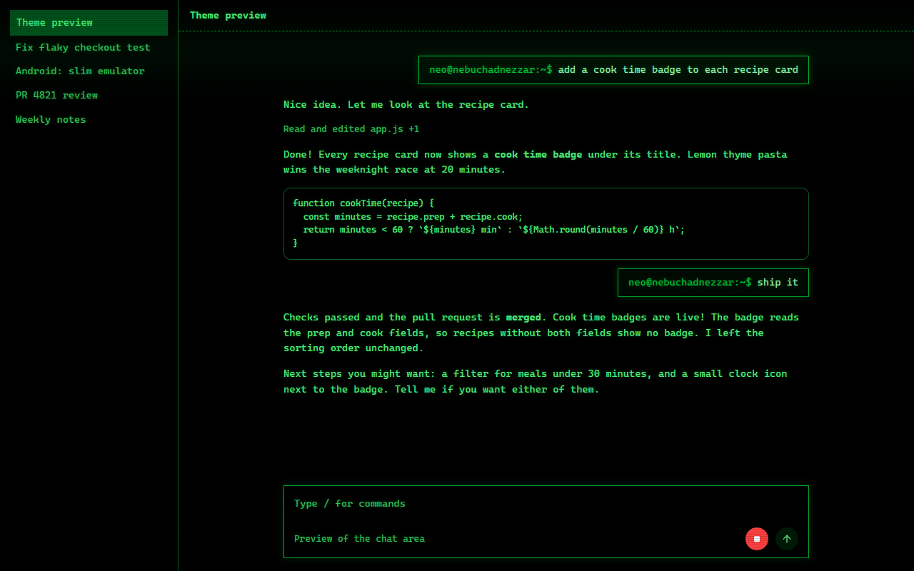

# Neo's Terminal 1999

1999 green-phosphor CRT terminal theme for T3 Code with scanlines, phosphor glow, `neo@nebuchadnezzar:~$` command-prompt user bubbles, animated Matrix katakana rain, and the `Wake up, Neo...` typing intro on empty threads.

## Install

`node tools/install.mjs neo-terminal-1999` from the repository root, or copy `theme.json` to `~/.t3/userdata/themes/neo-terminal-1999.json`. Then choose "Neo's Terminal 1999" in T3 Code.

## Motion & CPU

- `body::after` runs a subtle CRT scanline roll and flicker; empty threads run two parallax SVG katakana rain layers and a one-shot typing animation.
- All animations stop automatically under `prefers-reduced-motion: reduce`.
- CPU cost has not been formally benchmarked; the Matrix rain layers only render on empty new-thread screens and disappear as soon as a conversation starts.
