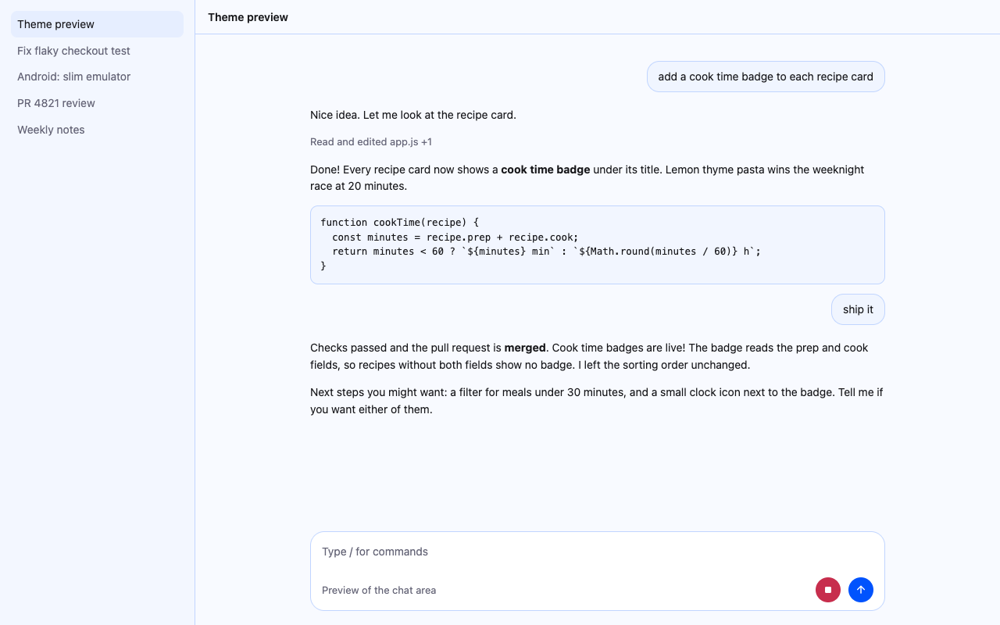
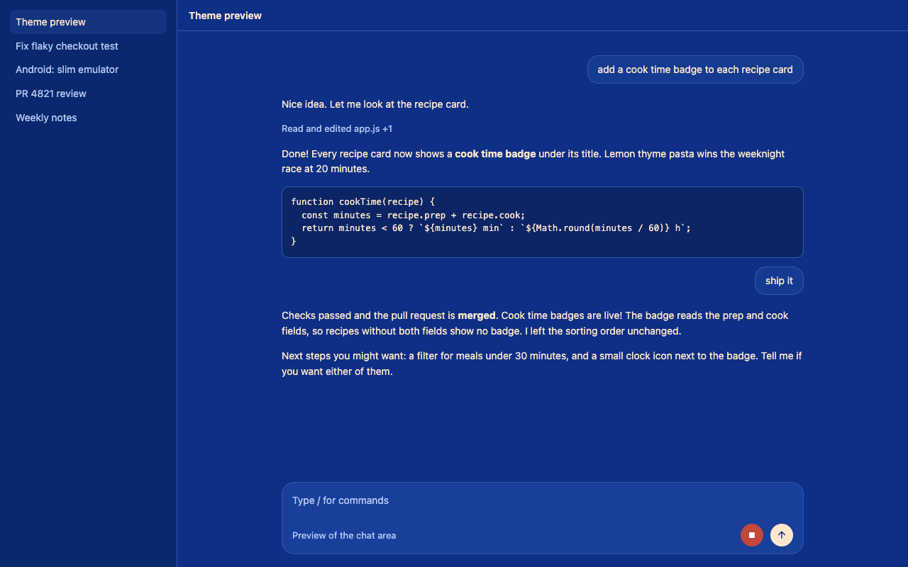

# Nous Alt

Cream on mission blue in dark mode, glass neutrals with brand blue in light mode. From the Hermes Desktop skin.

## Credit

By [soya-miruku](https://github.com/soya-miruku). Imported from [soya-miruku/t3code-themes](https://github.com/soya-miruku/t3code-themes) at commit `7ed04e88e8`, file `themes/nous-alt.json`, under the MIT license. The license text is in [third-party/soya-miruku-t3code-themes](../../third-party/soya-miruku-t3code-themes).

Changed here: the gallery-only fields (id, author, description, collection) moved to `meta.json`. The colours are as the author wrote them.

## Install

`node tools/install.mjs nous-alt` from the repository root, or copy `theme.json` to `~/.t3/userdata/themes/nous-alt.json`. Then choose "Nous Alt" in T3 Code.
