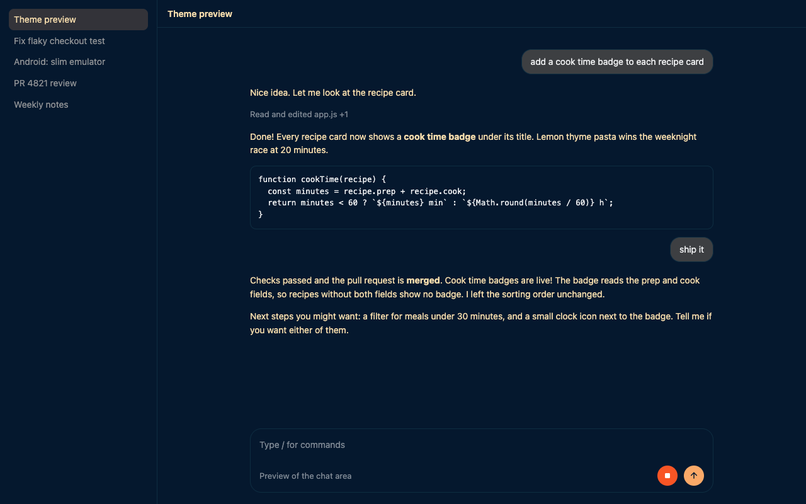

# Omarchy — Retro 82

The Retro 82 palette from Omarchy, as a T3 Code theme.

## Credit

By [rblalock](https://github.com/rblalock). Imported from [rblalock/t3code-omarchy-themes](https://github.com/rblalock/t3code-omarchy-themes) at commit `8016895ce7`, file `themes/retro-82.json`, under the MIT license. The license text is in [third-party/rblalock-t3code-omarchy-themes](../../third-party/rblalock-t3code-omarchy-themes).

Changed here: the source is a VS Code theme file. T3 Code's own import code (vscodeThemeImport.ts at commit ef6e05e356) turned it into this T3 Code theme, as the app does when you import that file. The palette credits are in the NOTICE file.

## Install

`node tools/install.mjs omarchy-retro-82` from the repository root, or copy `theme.json` to `~/.t3/userdata/themes/omarchy-retro-82.json`. Then choose "Omarchy — Retro 82" in T3 Code.
