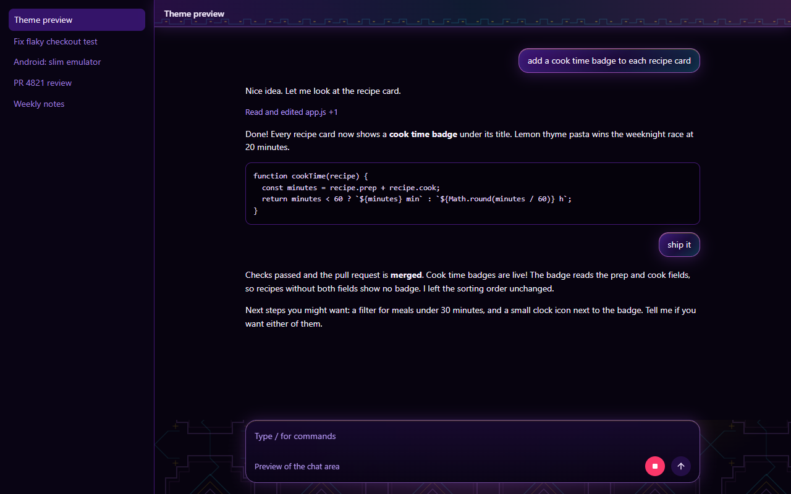

# Shipibo Kené Overdrive

Sacred Shipibo Kené geometric tapestry theme for T3 Code on deep cosmic violet with electric cyan, magenta, and gold accents.

## Install

`node tools/install.mjs shipibo-kene-overdrive` from the repository root, or copy `theme.json` to `~/.t3/userdata/themes/shipibo-kene-overdrive.json`. Then choose "Shipibo Kené Overdrive" in T3 Code.

## Motion & CPU

- Static inline SVG geometric patterns on the conversation canvas, sidebar, header, user bubbles, and code blocks.
- Only the composer's `:focus-within` glow animates (`keneBreath`), and it stops automatically under `prefers-reduced-motion: reduce`.
- CPU cost has not been formally benchmarked; there is no continuous background animation when idle.
