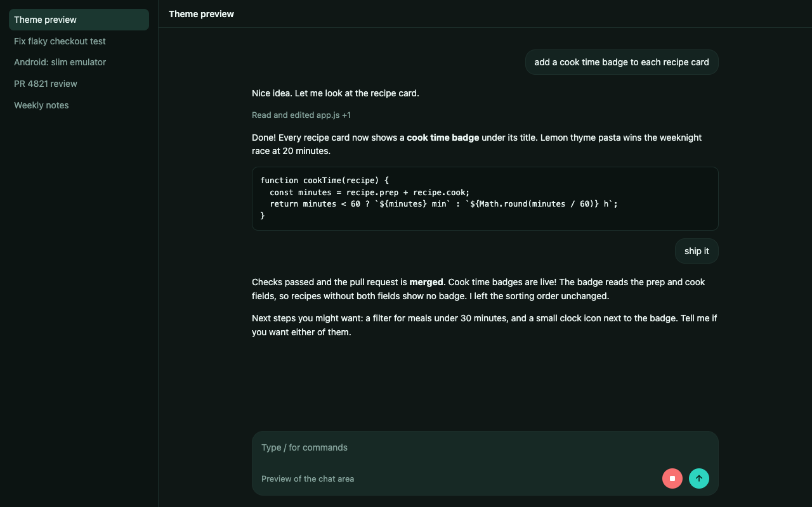
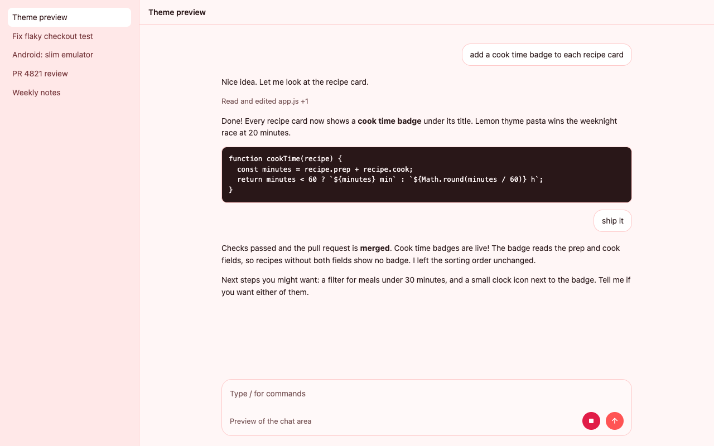

# Vertical

Liquid-glass gradients in the style of Arc Browser: emerald glass in dark mode, coral sunset in light mode.

## Credit

By [LuiiHer](https://github.com/LuiiHer). Imported from [LuiiHer/t3code-themes](https://github.com/LuiiHer/t3code-themes) at commit `11c698c94e`, file `themes/vertical.json`, under the MIT license. The license text is in [third-party/LuiiHer-t3code-themes](../../third-party/LuiiHer-t3code-themes).

Changed here: the gallery-only fields (id, author, description, collection) moved to `meta.json`. The colours are as the author wrote them.

## Install

`node tools/install.mjs vertical` from the repository root, or copy `theme.json` to `~/.t3/userdata/themes/vertical.json`. Then choose "Vertical" in T3 Code.
